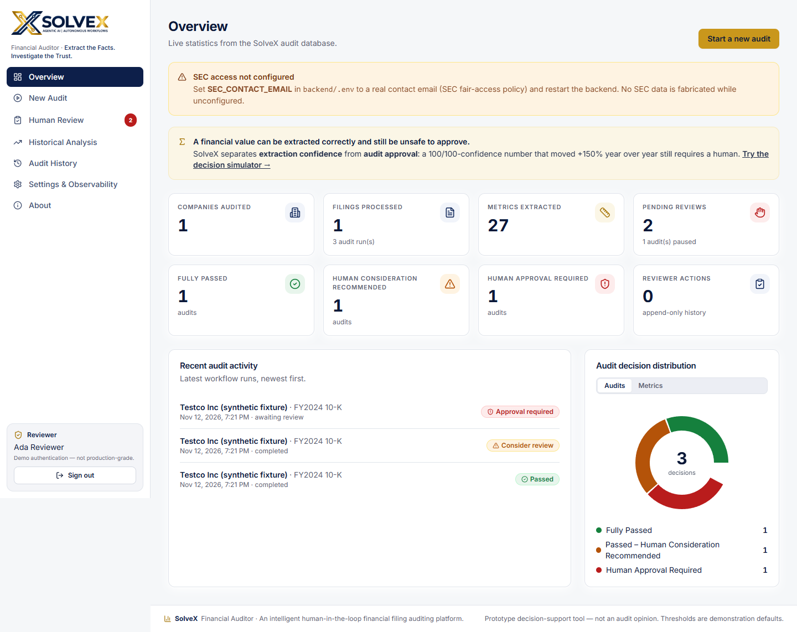

<p align="center"></p>

# SolveX Financial Auditor

**Extract the Facts. Investigate the Trust.**
An intelligent human-in-the-loop financial filing auditing platform.

SolveX retrieves real **SEC EDGAR Form 10-K** filings, extracts key financial metrics with source evidence, verifies them against **SEC XBRL
Company Facts**, runs deterministic accounting validations and anomaly investigations, scores **evidence-based confidence**, and **pauses a
LangGraph workflow for mandatory human review** when the evidence says it should.

> **A financial value can be extracted correctly and still be unsafe to approve.**
> A revenue figure extracted with 100/100 confidence that moved $200M → $500M (+150%) is still **Human Approval Required** — no model can override that.



## What it does

| | |
|---|---|
| **Real SEC data** | Company search/CIK resolution, 10-K list, original filing HTML (inline XBRL), XBRL Company Facts. Cached, rate-limited (≤ 8 req/s), exponential backoff, timeouts, truthful User-Agent. SEC failure ⇒ visible error, **never fabricated data**. |
| **9 metrics** | Revenue, Net Income, Total Assets, Total Liabilities, Shareholders' Equity, Operating Cash Flow, Cash & Equivalents, Operating Expenses, Capital Expenditure. Missing ⇒ recorded as *missing*, never zero. |
| **Evidence** | Source URL, table/row/column location, snippet, XBRL concept, period, unit/currency, extraction method, re-verification. |
| **Confidence** | 7 stored signals (source, parsing, concept mapping, units, period, XBRL agreement, evidence completeness). Not random, not approval. |
| **Validation** | A = L + E, missing data, unit & period mismatch, sign checks, unusual scaling, restatement detection — each stores inputs, formula, result, tolerance, status, explanation. |
| **Anomalies** | YoY change vs thresholds, baseline, severity — an *investigation signal, not proof of fraud*. |
| **3-level decision** | Fully Passed · Passed – Human Consideration Recommended · Human Approval Required. Pure Python; highest severity wins. |
| **XBRL ground truth** | matched / mismatched / missing / unable-to-match with real counts and methodology (no unverified accuracy claims). |
| **Human-in-the-loop** | LangGraph `interrupt` + SQLite checkpoints; approve / correct / reject; notes required for correct/reject; append-only history; originals preserved; auto-resume from the checkpoint. |
| **Explainability** | Observed facts · deterministic calculations · AI text — shown separately. |
| **Observability** | SEC health, LLM tokens/latency/retries/cost, workflow compute vs wall-clock time, threshold change log. |
| **Works without an LLM** | The core pipeline is deterministic. An LLM (Anthropic or any OpenAI-compatible endpoint) is optional and can only pick a table row or paraphrase an explanation. |

## Quick start

Prerequisites: **Python 3.11+**, **Node.js 18+** (npm), Git. Windows PowerShell shown; macOS/Linux equivalents in comments.

### 1 · Backend  → http://localhost:8000  (API docs: http://localhost:8000/docs)

```powershell
cd backend
python -m venv .venv
.\.venv\Scripts\Activate.ps1            # macOS/Linux: source .venv/bin/activate
pip install -r requirements.txt
copy .env.example .env                  # macOS/Linux: cp .env.example .env
#   → edit backend/.env: set SEC_CONTACT_EMAIL (required for live SEC) and change REVIEWER_TOKEN
uvicorn app.main:app --reload --port 8000
```

The database (`backend/data/solvex.db`) is created and migrated with Alembic automatically on startup.
(Manual migration: `alembic upgrade head`.)

### 2 · Frontend  → http://localhost:5173

```powershell
cd frontend
npm install
npm run dev
```

Open http://localhost:5173, sign in with any reviewer name and the `REVIEWER_TOKEN` from `backend/.env`.

> **SEC requires a real contact email.** Set `SEC_CONTACT_EMAIL` in `backend/.env`; SolveX sends it only to SEC as part of the User-Agent
> (`SolveX Financial Auditor/1.0.0 (contact: you@yourco.com)`). Without it, SEC features show a clear "not configured" error.

### 3 · Try it

1. **New Audit** → search *Apple / Microsoft / NVIDIA / Amazon / Alphabet* → pick a Form 10-K → **Start audit** and watch the live (SSE) progress.
2. **Audit results** → metrics with confidence, validation, anomaly, XBRL status and decision → open **Evidence** for the full explanation.
3. NVIDIA's recent revenue growth (> 100% YoY) demonstrates the override with real data: high confidence, XBRL-matched, **still requires a human**.
4. **Human Review** → approve / correct (value + notes) / reject → when the last mandatory item is resolved the workflow resumes from its checkpoint.
5. **Settings → Decision simulator** runs the real decision engine on *$200M → $500M @ 100/100 confidence* → **Human Approval Required**.
6. Export the report as **PDF** from a completed audit.

Live-extraction sanity check against SEC (uses a throwaway DB):
`python scripts/live_smoke.py AAPL` (from `backend/`, after setting `SEC_CONTACT_EMAIL`).

## Tests

```powershell
cd backend ; .\.venv\Scripts\python -m pytest -q       # 43 tests
cd frontend ; npm run typecheck ; npm run build
```

The suite uses clearly synthetic fixtures ("Testco Inc") served through an HTTP mock transport — **no network**. It covers: normal audit → Fully
Passed; non-blocking warning; low confidence; accounting failure; **100/100 confidence + mandatory anomaly → Human Approval Required**; human
correction retaining original & corrected values; workflow resume without repeated SEC calls/stages; XBRL mismatch; missing history →
*Insufficient History*; SEC failure → visible error, no fabricated result; plus currencies, negative values, zero baselines, restatements,
duplicate requests, checkpoint recovery after a crash, append-only history, threshold guard rails, reviewer authentication, SSE, PDF and LLM-usage tracking.

## Project layout

```
backend/app/{api,agents,services,models,schemas,database,workflows,utils}   FastAPI · LangGraph · SQLAlchemy
backend/alembic/                                                              migrations
frontend/src/{pages,components,layouts,hooks,services,types,utils}            React + TS + Vite + Tailwind + shadcn-style UI
docs/ARCHITECTURE.md                                                          workflow, rules, data model
```

## API (full interactive docs at `/docs`)

`GET /api/health` · `GET /api/companies/search` · `GET /api/companies/{cik}/filings` · `POST /api/audits/start` · `GET /api/audits` ·
`GET /api/audits/{id}` · `GET /api/audits/{id}/progress` (SSE or JSON) · `GET /api/audits/{id}/metrics` · `GET /api/audits/{id}/report?format=json|pdf` ·
`GET /api/metrics/{id}` · `/evidence` · `/explanation` · `GET /api/reviews/pending` · `POST /api/reviews/{id}/approve|correct|reject` ·
`GET /api/reviews/history` · `GET /api/analytics/summary|trends` · `GET /api/settings` · `PATCH /api/settings/thresholds` ·
`GET /api/observability/usage` · `POST /api/decision/simulate`.

## Honest limitations

* Reviewer sign-in is **demo authentication** (shared token). It is not production-grade authentication.
* Thresholds (98 / 90 / 50% / 25%) are **demonstration defaults**, not accounting standards.
* Extraction is deterministic and label-based. It is built for the primary consolidated statements of large US filers; unusual presentations may produce
  *missing* metrics or low confidence — which correctly route to human review rather than guessing. Some companies don't report a metric
  (e.g. Amazon has no "Total liabilities" line) — it is reported as missing, not derived.
* Segment consistency is reported as *skipped* (not comparable across companies) rather than approximated.
* SolveX is decision-support software, **not an audit opinion**.

## Security

Secrets live only in `backend/.env` (git-ignored; see `.env.example`) and are never sent to the frontend. Reviewer and settings endpoints
require the demo token; every review/threshold change is an append-only audit record. Never commit `.env`, databases, SEC caches, `node_modules` or virtualenvs.

© SolveX · MIT License
